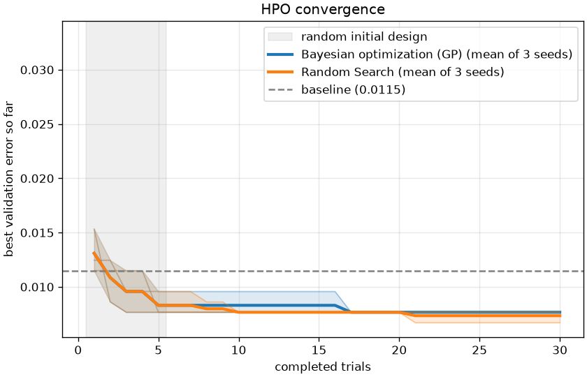
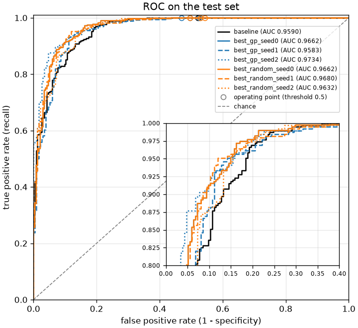

# Pneumonia Detection from Pediatric Chest X-Rays with AlexNet Transfer Learning and Hyperparameter Optimization

[](https://github.com/emirhantash/chest-xray-pneumonia-transfer-learning/actions/workflows/ci.yml)
[](LICENSE)
[](https://www.python.org/downloads/)

BİM 541 course project (Erciyes University). Binary classification (Normal vs Pneumonia) on
the Kaggle "Chest X-Ray Images (Pneumonia)" dataset with an ImageNet-pretrained AlexNet
(PyTorch), followed by hyperparameter optimization (Bayesian optimization vs. Random Search).

**Status:** All experiments are done: baseline, six HPO studies (Bayesian optimization and
Random Search, three seeds each), retraining of their best configurations, and a single final
evaluation on the test set. See [Results](#results). In short, HPO lowered the validation
error from 1.15 % to 0.67–0.77 %, but on the test set every model reaches 80–82 % accuracy:
pneumonia recall is 100 %, while only about half of the normal images are classified
correctly. Validation scores do not predict test performance on this dataset.

## Setup

Requires Python ≥ 3.11 and scikit-learn ≥ 1.8. The train/val split is read from a file
committed to the repository (`splits/patient_seed42.csv`), so it is the same on every
machine; recomputing it requires scikit-learn ≥ 1.8 (see
[D9](docs/deviations_from_interim_report.md#d9-the-patient-level-split-depends-on-the-scikit-learn-version-decided-phase-15)).

```bash
git clone https://github.com/emirhantash/chest-xray-pneumonia-transfer-learning.git
cd chest-xray-pneumonia-transfer-learning
python -m venv .venv
# Windows: .venv\Scripts\activate    macOS/Linux: source .venv/bin/activate

# 1) Install PyTorch for your hardware (CUDA / CPU / Apple MPS):
#    https://pytorch.org/get-started/locally/
# 2) Install the remaining dependencies:
pip install -r requirements.txt
```

The code picks the device automatically in this order: CUDA, then Apple MPS, then CPU.

## Data

Dataset: [Chest X-Ray Images (Pneumonia)](https://www.kaggle.com/datasets/paultimothymooney/chest-xray-pneumonia)
by Paul Mooney (a version of the data released by Kermany et al.). The data is **not**
included in this repository.

**Option A: Kaggle CLI**

```bash
pip install kaggle
# Put your API token (Kaggle > Settings > API > Create New Token) in
# ~/.kaggle/kaggle.json (Windows: C:\Users\<you>\.kaggle\kaggle.json)
kaggle datasets download -d paultimothymooney/chest-xray-pneumonia -p data/
# Extract the archive into data/ (e.g. with your OS's unzip tool)
```

**Option B: Manual download.** Download the zip from the Kaggle page and extract it.

The archive contains the same folder twice (`chest_xray/` and `chest_xray/chest_xray/`) plus
a `__MACOSX/` folder. Use either copy and point `data.root` to the folder that **directly**
contains `train/` and `test/`:

```
<data.root>/
├── train/  NORMAL/ (1,341)  PNEUMONIA/ (3,875)
├── test/   NORMAL/ (234)    PNEUMONIA/ (390)
└── val/    (16 images, not used)
```

The default `data.root` is `data/chest_xray` (inside the repo, gitignored). For data stored
elsewhere, edit `configs/baseline.yaml` or pass `--data-root`:

```bash
python scripts/check_data.py --config configs/baseline.yaml --data-root "C:/Users/<you>/Documents/chest_xray"
```

On Kaggle notebooks the path is `/kaggle/input/chest-xray-pneumonia/chest_xray`.

## Data protocol

- **Original test set (624 images)**: used only for the final evaluation, never for
  training, early stopping, or hyperparameter selection.
- **Original val folder (16 images)**: not used (too small to be meaningful).
- **Train / validation**: the original train set (5,216 images) is split ≈80/20, stratified
  by class, with a fixed seed, at the **patient level** (`split.mode: patient`). The patient
  ID is parsed from the file name (`person<ID>_...`, `IM-<ID>-...`,
  `NORMAL2-IM-<ID>-...`), so all images of a patient end up in the same subset. The
  resulting assignment (4,172 train / 1,044 val images) is saved in
  `splits/patient_seed42.csv` (`split.file`) and read from there; `scripts/make_split.py`
  regenerates it.
- **Class imbalance**: inverse-frequency class weights `n / (K * n_c)` computed on the
  training subset are used in `CrossEntropyLoss`.
- **Preprocessing**: grayscale, resized to 227 × 227, replicated to 3 channels, normalized
  with ImageNet mean/std.

## Sanity check

```bash
python scripts/check_data.py --config configs/baseline.yaml
```

This script:
- compares the class counts with the expected values;
- prints the train/val/test sizes, class ratios, patient counts, and class weights;
- reports patient-ID overlap between subsets;
- saves the split file list (`outputs/check_data/split_<mode>_seed<seed>.csv`) and a
  sample image grid (`outputs/check_data/samples.png`);
- passes one batch through AlexNet and checks the output shape.

It prints `ALL CHECKS PASSED` and exits with code 0 on success. Use `--no-pretrained` to
skip the ImageNet weight download (offline).

## Training

```bash
python scripts/train.py --config configs/baseline.yaml --data-root <path>
```

This trains for a fixed number of epochs (`train.epochs`) on the training subset and
evaluates on the validation subset after every epoch. The model after the **final epoch**
is the result of the run: there is no early stopping and no best-epoch selection (see
[D10](docs/deviations_from_interim_report.md#d10-training-loop-and-model-selection-decided-phase-2)).
The original test set is not touched.

Outputs go to `outputs/<run_name>/` (`--output-dir` and `--run-name` override the config):

| File | Content |
|---|---|
| `config.yaml`, `run_info.json` | effective config; library versions, device, split hash |
| `history.csv` | per-epoch train loss/accuracy and validation loss, accuracy, error, recall, specificity, precision, F1, balanced accuracy, AUC |
| `last.pt` | checkpoint after the latest epoch (≈435 MB; the final model once the run is complete) |
| `val_metrics.json`, `val_predictions.csv` | final-model validation metrics and per-image predictions |
| `curves.png`, `confusion_val.png`, `roc_val.png` | learning curves, confusion matrix, ROC curve |

**Resuming.** A checkpoint (model, optimizer, AMP scaler, history, RNG states) is written
atomically after every epoch. After an interruption, run the same command with `--resume`
to continue from the last completed epoch; the resumed run uses the config stored in the
checkpoint and gives the same weights as an uninterrupted run on the same device (tested
on CPU).

**Speed and memory.** Mixed precision (`train.amp`) is used on CUDA only; MPS and CPU train
in float32. With `data.cache: true` the resized grayscale images are kept in RAM
(≈270 MB); without worker processes (`data.num_workers: 0`) this is ~3× faster than with
workers on Windows. Training needs under 1 GB of GPU memory at batch size 8–64 (AMP).

**Colab / Kaggle.** [`notebooks/colab_kaggle_runner.ipynb`](notebooks/colab_kaggle_runner.ipynb)
clones the repository, installs the dependencies, locates the dataset, writes outputs to
Google Drive (Colab) or `/kaggle/working` (Kaggle), and resumes automatically when a
checkpoint exists.

## Evaluation

```bash
python scripts/evaluate.py --run outputs/baseline                     # validation set
python scripts/evaluate.py --run outputs/baseline --split test --final
```

Metrics are computed with PNEUMONIA as the positive class: confusion matrix, accuracy,
error (1 − accuracy), recall (sensitivity), specificity, precision, F1, balanced accuracy,
and ROC AUC. A sample is predicted as pneumonia when P(pneumonia) ≥ 0.5
(`eval.threshold`, fixed). The **test set is evaluated only with an explicit
`--split test --final`**, once, for the final models; it is never used to select models,
epochs, thresholds, or hyperparameters.

## Hyperparameter optimization

Bayesian optimization with a Gaussian process (Optuna `GPSampler`) is compared with Random
Search (`RandomSampler`) under the same conditions (`configs/hpo.yaml`, details in
[D13](docs/deviations_from_interim_report.md#d13-hpo-protocol-decided-phase-3)):

| | |
|---|---|
| Search space | lr [1e-4, 1e-2] log, batch size {8, 16, 32, 64}, epochs [5, 30], weight decay [1e-5, 1e-3] log, momentum [0.8, 0.99] |
| Objective | validation error (1 − accuracy) of the final-epoch model; a failed trial (diverged, or predicting one class for every image) gets the error of the majority-class predictor (0.2577) |
| Budget | 30 completed trials per study; sampler seeds 0, 1, 2 for each method |
| Fixed | training seed, split, preprocessing, class weights, AMP; no pruning |

```bash
python scripts/hpo.py --method gp --seed 0 --data-root <path>       # Bayesian optimization
python scripts/hpo.py --method random --seed 0 --data-root <path>   # Random Search
python scripts/compare_hpo.py                                       # summary table and plots
python scripts/train.py --config outputs/hpo/gp_seed0/best_config.yaml --data-root <path>
```

Each study lives in `outputs/hpo/<method>_seed<seed>/` (`study.db`, `trials.csv`,
`best_config.yaml`). Rerunning the same command resumes an interrupted study at the last
completed trial; the interrupted trial is repeated with the same parameters. With
`--backup-dir`, the SQLite file stays on local disk and is copied (e.g. to Google Drive)
after every trial. `compare_hpo.py` writes `summary.csv` (best, mean of the five best and
median error, trials that beat the baseline, failed trials, best error of the random
initial design and of the later trials), the best-so-far curves of both methods with the baseline as
reference, all trial errors, and each hyperparameter vs the error. With the same seed,
both methods share their first five (random) trials, so the comparison is paired. On the
development GPU (RTX 3050 Ti, AMP, image cache) one epoch takes 9–18 s depending on the
batch size, i.e. roughly 2 hours per study.

## Final evaluation

After all studies are finished and their best configurations retrained, the baseline and
every retrained model are evaluated on the test set **once**
([D15](docs/deviations_from_interim_report.md#d15-final-test-evaluation-decided-phase-4)):

```bash
python scripts/final_eval.py --final --data-root <path>   # writes outputs/final/
```

It reports every model's test metrics with 95 % confidence intervals from a patient-level
bootstrap (2,000 replicates), the paired accuracy difference to the baseline and an exact
McNemar test, and the mean ± standard deviation of each method over its three seeds
(`model_metrics.csv`, `method_summary.csv`, `results.md`, `roc_test.png`). A model that
already has test predictions is not evaluated again.

## Results

All numbers below were measured with the code in this repository on one RTX 3050 Ti Laptop
GPU. Validation is the patient-level 20 % of the original train folder (1,044 images); test
is the original test folder (624 images: 234 normal, 390 pneumonia), evaluated once after
every training and HPO decision was fixed. Raw outputs are under `outputs/` (not committed).

### Hyperparameter optimization (validation set)

| Study | Best val error (%) | Mean of 5 best (%) | Median (%) | Trials better than baseline | Failed trials | Best configuration (lr, batch, epochs) | Hours |
|---|---|---|---|---|---|---|---|
| baseline | 1.15 | – | – | – | – | 1.0e-3, 16, 15 | 0.2 |
| GP, seed 0 | 0.77 | 0.84 | 1.77 | 8 / 30 | 6 | 1.8e-4, 32, 23 | 1.4 |
| GP, seed 1 | 0.77 | 0.88 | 1.44 | 7 / 30 | 4 | 1.1e-3, 16, 30 | 1.6 |
| GP, seed 2 | 0.77 | 0.86 | 1.63 | 7 / 30 | 2 | 1.5e-4, 8, 27 | 1.9 |
| Random, seed 0 | 0.77 | 0.92 | 1.25 | 9 / 30 | 5 | 1.8e-4, 32, 23 | 1.7 |
| Random, seed 1 | 0.77 | 0.90 | 1.34 | 8 / 30 | 2 | 2.1e-4, 32, 25 | 1.5 |
| Random, seed 2 | 0.67 | 0.79 | 1.34 | 10 / 30 | 6 | 1.1e-3, 32, 20 | 1.5 |



- Every study beats the baseline (12 errors): five reach 8 errors (0.77 %), Random Search
  with seed 2 reaches 7 (0.67 %). The studies differ by at most one image out of 1,044, so the
  validation set is close to its ceiling and cannot separate the two methods.
- With seed 0, both methods found their best configuration in the shared random initial
  design (the first five trials, identical for both methods,
  [D13](docs/deviations_from_interim_report.md#d13-hpo-protocol-decided-phase-3)), so
  `gp_seed0` and `random_seed0` are the same model.
- Averaged over seeds, the GP best-so-far curve is not lower than Random Search's.
- Retraining each best configuration reproduced the trial's validation error exactly
  ([D14](docs/deviations_from_interim_report.md#d14-final-models-of-the-hpo-methods-decided-phase-3)).

### Test set (final evaluation)

Brackets are 95 % patient-level bootstrap intervals (2,000 replicates); Δ is the paired
accuracy difference to the baseline in percentage points. Recall is 100 % (390 / 390) for
every model; all errors are false positives. Precision and F1 are in `model_metrics.csv`.
AUC and ROC curves are computed from the log-odds of the model output, because confident
probabilities saturate at 1.0 and would tie.

| Model | Val error (%) | Test accuracy (%) | Δ vs baseline (pp) | Specificity (%) | AUC | McNemar p |
|---|---|---|---|---|---|---|
| baseline | 1.15 | 80.4 [76.6, 83.9] | – | 47.9 | 0.959 [0.943, 0.972] | – |
| GP, seed 0 | 0.77 | 81.4 [77.8, 84.6] | +1.0 [−0.7, +2.7] | 50.4 | 0.966 [0.951, 0.979] | 0.36 |
| GP, seed 1 | 0.77 | 80.3 [76.4, 83.7] | −0.2 [−1.7, +1.4] | 47.4 | 0.958 [0.942, 0.973] | 1.00 |
| GP, seed 2 | 0.77 | 82.4 [78.7, 85.6] | +1.9 [+0.2, +3.9] | 53.0 | 0.973 [0.962, 0.984] | 0.058 |
| Random, seed 0 | 0.77 | 81.4 [77.8, 84.6] | +1.0 [−0.7, +2.7] | 50.4 | 0.966 [0.951, 0.979] | 0.36 |
| Random, seed 1 | 0.77 | 80.1 [76.3, 83.6] | −0.3 [−1.8, +1.1] | 47.0 | 0.968 [0.955, 0.980] | 0.84 |
| Random, seed 2 | 0.67 | 79.6 [75.8, 83.1] | −0.8 [−2.3, +0.6] | 45.7 | 0.963 [0.949, 0.976] | 0.38 |

| Method | Models | Test accuracy (%) | Specificity (%) | F1 (%) | AUC |
|---|---|---|---|---|---|
| baseline | 1 | 80.4 | 47.9 | 86.5 | 0.959 |
| Bayesian optimization (GP) | 3 | 81.4 ± 1.0 | 50.3 ± 2.8 | 87.0 ± 0.6 | 0.966 ± 0.008 |
| Random Search | 3 | 80.4 ± 0.9 | 47.7 ± 2.4 | 86.4 ± 0.5 | 0.966 ± 0.003 |



**Findings**

1. **Large validation–test gap.** About 99 % accuracy on validation drops to 80–82 % on test.
   Every model detects all pneumonia images but labels about half of the normal test images
   as pneumonia (specificity 46–53 %).
2. **The ranking is good; the fixed threshold does not fit the test data.** AUC is 0.96–0.97
   for every model, but normal test images get much higher pneumonia probabilities than normal validation
   images. For the baseline, the median P(pneumonia) of a normal test image is 0.65, and the
   lowest score of any pneumonia test image is 0.97. At the fixed threshold of 0.5 every
   model operates near a false positive rate of 0.5 (circles in the ROC plot), while the
   curves reach 92–96 % recall at a false positive rate of 0.15. The validation set
   comes from the same folder as the training data and shows no such shift, so a threshold
   chosen on validation would not have helped. Choosing one on the test set would be test-set
   tuning, which the protocol forbids
   ([D10](docs/deviations_from_interim_report.md#d10-training-loop-and-model-selection-decided-phase-2)).
   The cause of the shift (acquisition, labelling, or patient differences between the two
   folders) is not established here.
3. **Validation gains did not carry over to test accuracy.** Accuracy changes against the
   baseline range from −0.8 to +1.9 points. Only GP seed 2 has an interval that excludes
   zero (+1.9 [+0.2, +3.9]); its McNemar p is 0.058 and the six comparisons are not
   corrected for multiplicity, so this is not taken as evidence of an improvement. The model
   with the lowest validation error (Random, seed 2) has the lowest test accuracy. GP and
   Random Search differ by one point on average (81.4 ± 1.0 vs 80.4 ± 0.9 %), within the
   seed-to-seed spread, so no difference between the methods is claimed.
4. **HPO did not improve the ranking either.** The AUC of all seven models lies between
   0.958 and 0.973 with overlapping intervals (baseline 0.959 [0.943, 0.972]); the mean AUC
   of both methods is 0.966.

In short, on this dataset the validation split of the train folder is saturated and does not
predict test performance. The HPO objective (validation error at a fixed threshold) therefore
optimized a quantity that is already near its ceiling. Possible next steps (not done here):
- a threshold-free or probabilistic objective (AUC, log loss);
- data augmentation ([D5](docs/deviations_from_interim_report.md#d5-data-augmentation-open), still open);
- calibration or evaluation on data from other sources.

## Development

Install the development tools on top of the setup above:

```bash
pip install -r requirements-dev.txt
```

Run the tests and the linter from the repository root:

```bash
pytest                  # unit tests on a tiny synthetic dataset (no real data, no network)
ruff check .            # lint
ruff format .           # format (CI runs `ruff format --check .`)
```

The tests build a small fake dataset with the same folder layout and file-name conventions
as the real one, so they run anywhere, including CI. GitHub Actions runs `ruff check`,
`ruff format --check`, and `pytest` with CPU-only PyTorch on Python 3.11 for every push and
pull request to `main`. Tool settings (ruff, pytest) live in `pyproject.toml`.

## Project structure

```
configs/baseline.yaml      # hyperparameters and paths (baseline = interim report, Table 3)
configs/hpo.yaml           # search space and budget (interim report, Table 4)
splits/patient_seed42.csv  # the train/val assignment (file names only)
src/utils.py               # set_seed, seed_worker, load_config, get_device
src/data.py                # file listing, patient IDs, split (+ split file), transforms,
                           #   image cache, loaders, class weights
src/model.py               # build_alexnet
src/metrics.py             # confusion matrix, accuracy, recall, specificity, F1, AUC, ROC
src/engine.py              # optimizer, loss, train / evaluate loops, AMP
src/checkpoint.py          # atomic checkpoints, RNG state capture/restore
src/plots.py               # learning curves, confusion matrix, ROC figures
src/runner.py              # shared epoch loop, resumable training run, evaluation of a run
src/hpo.py                 # Optuna studies (GP vs Random), resume logic, analysis
src/stats.py               # patient-level bootstrap intervals, exact McNemar test
src/report.py              # final test-set report (tables, comparisons with the baseline)
scripts/check_data.py      # data/split/model sanity checks
scripts/make_split.py      # computes and saves the split file
scripts/train.py           # training entry point
scripts/evaluate.py        # evaluation entry point (test set only with --final)
scripts/hpo.py             # runs or resumes one HPO study
scripts/compare_hpo.py     # compares the studies (table and plots)
scripts/final_eval.py      # final test evaluation of the baseline and the HPO models
scripts/check_patient_overlap.py   # are shared train/test patient IDs the same patients?
notebooks/colab_kaggle_runner.ipynb   # runs the pipeline on Colab / Kaggle GPUs
tests/                     # pytest suite on synthetic data (fixtures in conftest.py)
docs/deviations_from_interim_report.md   # what changed since the interim report and why
docs/figures/                            # figures used in this README (copied from outputs/)
pyproject.toml             # project metadata, ruff and pytest settings
requirements.txt           # runtime dependencies (install PyTorch first)
requirements-dev.txt       # pytest, ruff
.github/workflows/ci.yml   # CI: lint + tests on CPU
```

## Reproducibility

All randomness (Python, NumPy, PyTorch, DataLoader shuffling and workers, the split) is
controlled by `seed` in the config through `src.utils.set_seed`. The shuffling generator
is re-seeded with `seed + epoch` at the start of every epoch, so a resumed run sees the
same batches as an uninterrupted one. cuDNN is set to deterministic mode, but some CUDA
kernels are not bit-exact between runs, and runs on Apple MPS may not be either. Library
versions, the device, and the git commit of every run are saved in `run_info.json` (and
with every HPO session).

## Limitations

- **Patient IDs are inferred from file names.** The dataset ships no official patient
  metadata. The split assumes the file-name convention identifies patients; this has not been
  verified against the original source. With `split.mode: image` (the interim report's
  setting), images of the same patient can fall into both train and validation, which makes
  validation scores optimistic. In the original train folder, 1,005 of 1,635 pneumonia
  patient IDs have more than one image.
- **Approximate 80/20 split.** The patient-level split (StratifiedGroupKFold, first of 5 folds)
  guarantees the class ratio and the 80/20 share only approximately (seed 42 with
  scikit-learn ≥ 1.8: 4,172 train / 1,044 val, 74.3% / 74.2% pneumonia). Older scikit-learn
  versions produce a different split for the same seed. With the image-level split, 469 of
  the 847 patient IDs in validation also appear in training.
- **Aspect-ratio distortion.** Images vary widely in size and aspect ratio and are resized
  directly to 227 × 227 without cropping or padding.
- **Channel-format artifact.** 283 training pneumonia images are stored as RGB; all other
  images are grayscale. All images are converted to grayscale first so that the channel
  format cannot act as a shortcut feature.
- **Train/test patient overlap.** 170 parsed patient IDs appear in both the original train
  and test folders. An image-similarity check (`scripts/check_patient_overlap.py`, details
  in [D8](docs/deviations_from_interim_report.md#d8-patient-ids-shared-between-original-train-and-test-folders-decided-phase-4))
  finds no duplicates and no sign that they are the same patients (the numbering appears to
  restart per folder), but cannot fully rule it out. The original test split is kept
  unchanged for comparability with published work.
- **Validation does not reflect the test set.** The validation split comes from the
  original train folder and is nearly saturated (0.67–1.15 % error), whereas the test folder
  shows a strong shift towards false positives (see [Results](#results)). Model and
  hyperparameter choices made on validation therefore say little about test performance.
- **Single source, pediatric only.** All images come from one center (Guangzhou Women and
  Children's Medical Center) and from patients aged 1–5, which limits how well results
  generalize to adults or other devices and sites.
- **Resolution mismatch.** torchvision's AlexNet was pretrained at 224 × 224; 227 × 227 is
  used to match the interim report (it works because of the adaptive pooling layer).

## License

[MIT](LICENSE)
